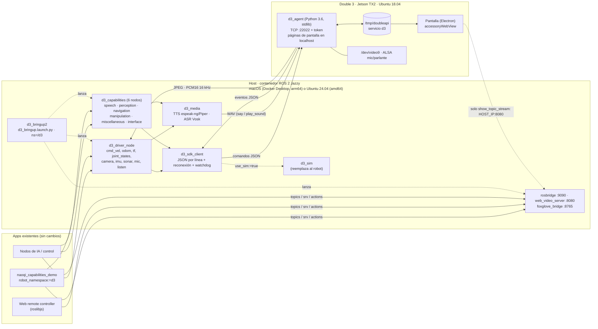

# double3_ros2_bringup2

Bringup **ROS 2 Jazzy** para el robot de telepresencia **Double 3**. Expone el **mismo contrato ROS 2**
que [`naoqi_bringup2_SinfonIA`](https://github.com/SinfonIAUniandes/naoqi_bringup2_SinfonIA) (Pepper/NAO):
mismos nombres y tipos de topics, servicios y acción bajo `/<namespace>/`. Así, las apps hechas para
Pepper (el capabilities demo, el web remote controller vía rosbridge y los nodos de IA) funcionan con el D3
cambiando solo el namespace (`/pepper` → `/d3`).

> Proyecto de monitoría de investigación de la Universidad de los Andes (laboratorio COLIVRI).
> **No** es un repositorio oficial de SinfonIA, de la Universidad ni de Double Robotics. Ver [NOTICE](NOTICE).

## Estado

| | |
|---|---|
| Contrato | 76 interfaces: 33 supported, 19 partial, 3 noop, 18 unsupported, 3 planned ([matriz](contract/COMPATIBILITY.md)) |
| Simulador | `make sim`: 64/64 interfaces requeridas presentes con el tipo correcto (`make check`) |
| Demo SinfonIA | `naoqi_capabilities_demo.py` recorre todo el contrato contra `/d3` en simulación |
| Robot real | Pendiente de probar en el laboratorio: ver [docs/LAB.md](docs/LAB.md) |

## Arquitectura



- **ROS 2 corre fuera del robot.** El D3 tiene Ubuntu 18.04 y Python 3.6, así que Jazzy no puede correr
  ahí. En el robot solo va `d3_agent`, un archivo Python sin dependencias.
- **El host abre todas las conexiones hacia el D3** (comandos, video, audio, WAV). Por eso funciona igual
  detrás del NAT de Docker Desktop en macOS y con `network_mode: host` en Linux.
- **Todos los servicios del contrato existen siempre.** Los que no aplican al D3 (brazos, manos, LEDs...)
  responden `success=false, "unsupported on D3"`, así ningún cliente falla por un servicio ausente.

## Inicio rápido (sin robot)

Requisitos: Docker (Docker Desktop en Mac) y `make`.

```bash
cp .env.example .env      # en simulación no hace falta editarlo
make image                # imagen ROS 2 Jazzy (arm64 en Mac, amd64 en Ubuntu)
make build                # colcon build dentro del contenedor
make sim                  # bringup + simulador del D3 (Ctrl-C para salir)
```

En otra terminal:

```bash
make check                # compara el grafo ROS en vivo con contract/contract.yaml
make demo                 # corre el demo original de SinfonIA contra /d3
make shell                # shell con ROS cargado: ros2 topic list, ros2 service call /d3/say ...
```

- **Visualización en Mac**: Foxglove → `ws://localhost:8765`.
- **Web remote controller**: `ws://localhost:9090` con namespace `d3`.
- **Si un puerto del host está ocupado**: cámbialo en `.env` (`ROSBRIDGE_HOST_PORT=9091`, etc.).

## Con el robot real

Ver **[docs/LAB.md](docs/LAB.md)**: verificar el developer mode, instalar `d3_agent`, `make robot`,
grabar eventos y calibrar.

## Comandos

| Comando | Qué hace |
|---|---|
| `make image` / `make up` / `make down` | Construir, levantar y bajar el contenedor |
| `make build` | `colcon build --symlink-install` |
| `make sim` | Bringup con `use_sim:=true` (simulador + agente en perfil sim) |
| `make robot` | Bringup contra el D3 (`D3_IP` y `D3_TOKEN` de `.env`) |
| `make check` | Verifica el contrato en vivo (nombres y tipos) |
| `make demo` | Demo de conformidad de SinfonIA, no interactivo |
| `make test` | Pruebas unitarias e integración (sim → agente → cliente) |
| `make graph` | Grafo de código de los repos naoqi_* + matriz de compatibilidad |
| `make safety` | Busca IPs, MACs y secretos en los archivos versionados |

En Linux, el Makefile agrega `compose.linux.yaml` (red del host, DDS en la LAN, X11 para RViz).

## Estructura

| Paquete | Tipo | Contenido |
|---|---|---|
| [`d3_sdk_client`](d3_sdk_client) | ament_python | Cliente del protocolo (hilos, reconexión, `request`/`wait_event`, watchdog) y base de nodos |
| [`d3_agent`](d3_agent) | script (Python 3.6) | Corre en el D3: puente TCP ↔ `/tmp/doubleapi`, video, audio, reproducción y páginas de pantalla |
| [`d3_sim`](d3_sim) | ament_python | Simulador de la API del D3, con reproducción de fixtures |
| [`d3_driver`](d3_driver) | ament_python | Equivalente de `naoqi_driver` |
| [`d3_capabilities`](d3_capabilities) | ament_python | Equivalentes de los 6 nodos `naoqi_*` |
| [`d3_media`](d3_media) | ament_python | TTS y ASR en el host |
| [`d3_description`](d3_description) | ament_cmake | URDF simplificado |
| [`d3_bringup2`](d3_bringup2) | ament_cmake | Launch, `config/d3.yaml` y secuencia de arranque |
| [`contract/`](contract) | datos | `contract.yaml` (fuente de verdad), `check_contract.py`, `COMPATIBILITY.md` |
| [`tools/codegraph/`](tools/codegraph) | herramienta | Grafo de código de los repos naoqi_* cruzado con el contrato |

### Qué se emula de `naoqi_bringup2_SinfonIA` y qué es nuevo

- **Igual que el original:**
  - nombres y tipos de las interfaces;
  - argumentos del launch (`nao_ip`, `nao_port`, `namespace`, `driver_params_file`, `driver_*_topic`,
    `launch_video_server`);
  - forma del YAML (`bringup:` + `ros__parameters`);
  - secuencia de arranque encadenada con `ros2 service call`;
  - archivo `.repos`.
- **Nuevo:**
  - `contract.yaml`: el original no tiene un contrato explícito, y sus READMEs muestran nombres
    desactualizados (`/naoqi_<pkg>_node/...` en vez de `/<ns>/<srv>`);
  - el agente, el simulador y el grafo de código;
  - los argumentos `robot_ip`, `use_sim`, `launch_rosbridge` y `launch_foxglove`.

## Seguridad y datos

El repo es público. Lee **[SECURITY.md](SECURITY.md)** antes de tu primer commit: tokens, IPs, seriales,
grabaciones del robot y media con personas **nunca** se suben.

## Créditos

- Contrato ROS 2: [SinfonIA Uniandes](https://github.com/SinfonIAUniandes), con aportes de David Cuevas.
- Protocolo del robot: [Double 3 Developer SDK](https://github.com/doublerobotics/d3-sdk) (solo como referencia).

Licencia: [Apache-2.0](LICENSE).
